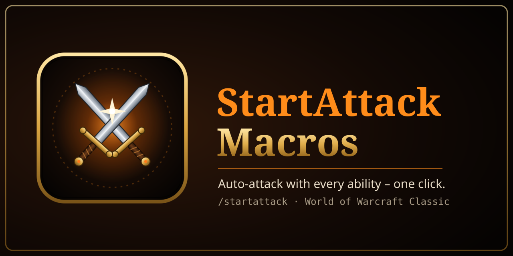

<p align="center">
  
</p>

<p align="center">
  <b>Never stand there doing nothing again. Every ability starts your auto-attack.</b><br>
  World of Warcraft Classic · WoW Forever · 10 languages
</p>

---

## What it does

In Classic, using an ability like *Sinister Strike* or *Heroic Strike* does **not**
always start your auto-attack, and that costs you a lot of damage. The usual fix is to write a
macro for every single ability:

```
#showtooltip Sinister Strike
/startattack
/cast Sinister Strike
```

**StartAttack Macros does that for you.**

- **Spellbook window**: all your attack abilities in one place. Click one (or drag it)
  and its `/startattack` macro is ready to drop onto your action bar.
- **One-click conversion**: replaces every attack ability on your action bars with its
  macro, in the same slot.
- **Smart**: only attack abilities are listed. Ranks are merged (always casts the highest rank),
  and Auto Attack / Shoot / Auto Shot are skipped.
- **Macro tracking**: a green check mark shows which abilities already have an up-to-date
  macro, a yellow question mark shows macros that do not match your current texts yet, and a
  counter shows your free macro slots.
- **Your own conditions**: type something like `[@mouseover,harm,nodead][]` into the window and
  it is inserted after `/cast` in every macro. A second field does the same for `/startattack`,
  for example `[harm,nodead]`. Untick a box to create a macro without that text.
- **Your own lines**: add commands such as `/petattack` before `/startattack`, between the two
  commands or after `/cast`, and text right after the spell name. Saved per character.
- **Mouseover macros for heals**: a second page lists your helpful spells (heals, cleanses,
  buffs) and creates `[@mouseover,help,nodead][]` macros for them, also in one click for your
  whole action bar.
- **Minimap button**, **Addon Compartment** entry and a full **options panel**.
- **Broker displays**: shows up as a launcher in Titan Panel, ChocolateBar and other
  LibDataBroker displays.
- Lightweight: no libraries, no dependencies.
- **10 languages**: English, Deutsch, Français, Español, Italiano, Português, Русский, 한국어, 简体中文, 繁體中文

## Why macros and not "automatic"?

Blizzard protects `StartAttack()`, so addons are not allowed to start your attack on their
own. Macros are the only allowed way. This addon builds and places them for you.

## Usage

| Command | Action |
|---|---|
| `/sam` | Open / close the window |
| `/sam convert` | Convert all attacks on your action bars |
| `/sam <spell name>` | Put the macro for one spell on your cursor |
| `/sam options` | Open the options |
| `/sam minimap` | Show / hide the minimap button |

Or: **Esc → Options → AddOns → StartAttack Macros**, or click the minimap button.

> Macros are named `+SpellName` and use character-specific macro slots first, then general ones.
> Nothing can be changed in combat (Blizzard restriction).

### Extra macro conditions

The fields **Add after /startattack** and **Add after /cast** at the bottom of the window take
any macro conditions. With `[harm,nodead]` and `[@mouseover,harm,nodead][]` the macros look like
this:

```
#showtooltip Sinister Strike
/startattack [harm,nodead]
/cast [@mouseover,harm,nodead][] Sinister Strike
```

- Tick a box to show its text field. Each tick box decides whether its text goes into the macros
  you create or convert next. Untick it and click an ability to get that one macro without the
  text; the text itself is kept for the next time you tick the box.
- When you change a text, macros that contain the old text are updated. Macros without it, and
  macros you edited by hand, are left alone.
- A yellow question mark on an ability means its macro differs from what the fields and tick
  boxes would produce now. Click the ability to update that macro, or press **Convert all
  attacks on your action bars** to update every macro the addon created.
- The trailing `[]` after `/cast` makes the macro fall back to your current target.
- `/startattack [harm,nodead]` only starts auto-attack on a hostile, living target. It no longer
  picks the nearest enemy when you have no target.

### Extra macro lines

The fields **Lines before /startattack**, **Lines before /cast** and **Lines after /cast** take
whole macro lines, one command per line:

```
#showtooltip Shadow Bolt
/petattack
/startattack
/use 13
/cast Shadow Bolt
/script UIErrorsFrame:Clear()
```

### Text after the spell name

The field **Add after the spell** attaches its text directly to the spell name in the `/cast`
line, without a space. With `(Rank 1)` the line becomes `/cast Shadow Bolt(Rank 1)`.

### All six positions

```
#showtooltip Spell
<Lines before /startattack>
/startattack <Add after /startattack>
<Lines before /cast>
/cast <Add after /cast> Spell<Add after the spell>
<Lines after /cast>
```

- Any slash command works, including those of other addons.
- Enter starts a new line. Click anywhere in the window to apply what you typed.
- The line fields and **Add after the spell** are saved per character, because commands like
  `/petattack` only make sense on some classes. The two condition fields stay account-wide.
- Tick box, yellow question mark and updating work the same way as for the condition fields.
- A macro can hold 255 characters. If your texts make it longer, the macro is created without
  them and you get a message in chat.

### Mouseover macros for helpful spells

The tab **Helpful spells** lists your heals, cleanses and buffs. The game only tells helpful from
harmful spells, so all three kinds show up here. Click or drag one to get a mouseover macro
without `/startattack`:

```
#showtooltip Flash Heal
/cast [@mouseover,help,nodead][] Flash Heal
```

- The spell goes to the friendly, living unit under your mouse, otherwise to your current target.
- The condition is a text field you can change, for example to
  `[@mouseover,help,nodead][help,nodead][@player]` to fall back to yourself.
- These macros are named `@SpellName`, so a spell that is both harmful and helpful can have an
  attack macro and a mouseover macro at the same time.
- **Convert all helpful spells on your action bars** replaces them in their slots and updates the
  mouseover macros the addon already created.
- Green check mark and yellow question mark work as on the attack page.

## Installation

- **CurseForge app**: search for *StartAttack Macros*.
- **Manual**: download the latest zip from
  [Releases](../../releases) and extract it into
  `World of Warcraft\_classic_era_\Interface\AddOns\`.

---

## Deutsch

**Jede Fähigkeit startet automatisch deinen Autoangriff.** Das Addon erstellt für deine
Angriffsfähigkeiten Makros mit `/startattack` und setzt sie auf Wunsch direkt in deine
Aktionsleisten.

- `/sam` öffnet das Fenster. Fähigkeit anklicken oder ziehen und in die Leiste legen.
- `/sam convert` ersetzt alle Angriffsfähigkeiten in den Leisten durch ihre Makros.
- Felder **Nach /startattack einfügen** und **Nach /cast einfügen** im Fenster: eigene
  Bedingungen wie `[harm,nodead]` bzw. `[@mouseover,harm,nodead][]` für alle Makros. Das
  Textfeld erscheint, sobald der Haken gesetzt ist; ohne Haken wird das Makro ohne den
  jeweiligen Text erstellt.
- Felder **Zeilen vor /startattack**, **Zeilen vor /cast** und **Zeilen nach /cast**: eigene
  Makrozeilen wie `/petattack` an jeder Stelle des Makros, pro Charakter gespeichert.
- Feld **Nach dem Zauber einfügen**: Text direkt hinter dem Zaubernamen, z. B. `(Rang 1)`.
- Erscheint als Eintrag in Broker-Leisten wie Titan Panel oder ChocolateBar (LibDataBroker).
- Grüner Haken = Makro ist aktuell, gelbes Fragezeichen = Makro passt noch nicht zu den
  aktuellen Texten. Fähigkeit anklicken oder **Alle Angriffe in den Leisten umwandeln** drücken,
  um die Makros zu aktualisieren.
- Reiter **Hilfreiche Zauber**: Mouseover-Makros (`[@mouseover,help,nodead][]`) für Heilungen,
  Reinigungen und Buffs, ohne `/startattack`. Die Makros heißen `@Zaubername`.
- Optionen: **Esc → Optionen → AddOns → StartAttack Macros**

---

## License

[MIT](LICENSE)
