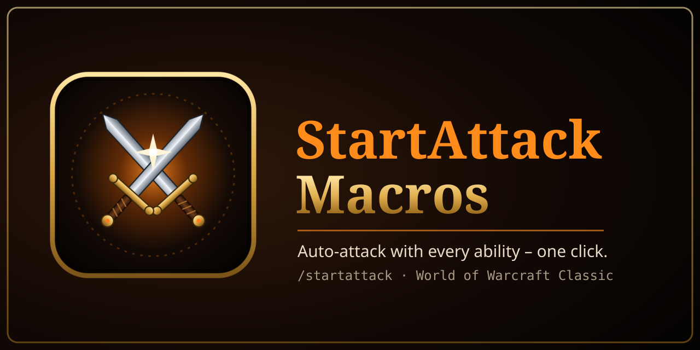

<p align="center">
  
</p>

<p align="center">
  <b>Never stand there doing nothing again. Every ability starts your auto-attack.</b><br>
  World of Warcraft Classic · WoW Forever · 10 languages
</p>

---

## What it does

In Classic, using an ability like *Sinister Strike* or *Heroic Strike* does **not**
always start your auto-attack, and that costs you a lot of damage. The usual fix is to write a
macro for every single ability:

```
#showtooltip Sinister Strike
/startattack
/cast Sinister Strike
```

**StartAttack Macros does that for you.**

- **Spellbook window**: all your attack abilities in one place. Click one (or drag it)
  and its `/startattack` macro is ready to drop onto your action bar.
- **One-click conversion**: replaces every attack ability on your action bars with its
  macro, in the same slot.
- **Smart**: only attack abilities are listed. Ranks are merged (always casts the highest rank),
  and Auto Attack / Shoot / Auto Shot are skipped.
- **Macro tracking**: a check mark shows which abilities already have a macro, and a counter
  shows your free macro slots.
- **Minimap button**, **Addon Compartment** entry and a full **options panel**.
- Lightweight: no libraries, no dependencies.
- **10 languages**: English, Deutsch, Français, Español, Italiano, Português, Русский, 한국어, 简体中文, 繁體中文

## Why macros and not "automatic"?

Blizzard protects `StartAttack()`, so addons are not allowed to start your attack on their
own. Macros are the only allowed way. This addon builds and places them for you.

## Usage

| Command | Action |
|---|---|
| `/sam` | Open / close the window |
| `/sam convert` | Convert all attacks on your action bars |
| `/sam <spell name>` | Put the macro for one spell on your cursor |
| `/sam options` | Open the options |
| `/sam minimap` | Show / hide the minimap button |

Or: **Esc → Options → AddOns → StartAttack Macros**, or click the minimap button.

> Macros are named `+SpellName` and use character-specific macro slots first, then general ones.
> Nothing can be changed in combat (Blizzard restriction).

## Installation

- **CurseForge app**: search for *StartAttack Macros*.
- **Manual**: download the latest zip from
  [Releases](../../releases) and extract it into
  `World of Warcraft\_classic_era_\Interface\AddOns\`.

---

## Deutsch

**Jede Fähigkeit startet automatisch deinen Autoangriff.** Das Addon erstellt für deine
Angriffsfähigkeiten Makros mit `/startattack` und setzt sie auf Wunsch direkt in deine
Aktionsleisten.

- `/sam` öffnet das Fenster. Fähigkeit anklicken oder ziehen und in die Leiste legen.
- `/sam convert` ersetzt alle Angriffsfähigkeiten in den Leisten durch ihre Makros.
- Optionen: **Esc → Optionen → AddOns → StartAttack Macros**

---

## License

[MIT](LICENSE)
